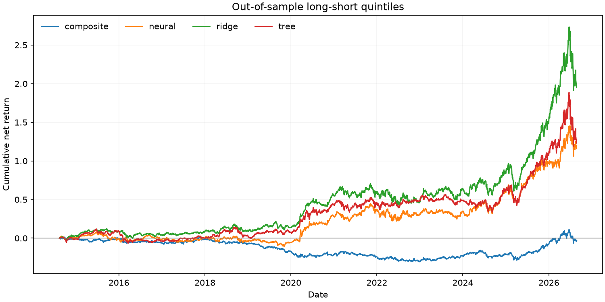
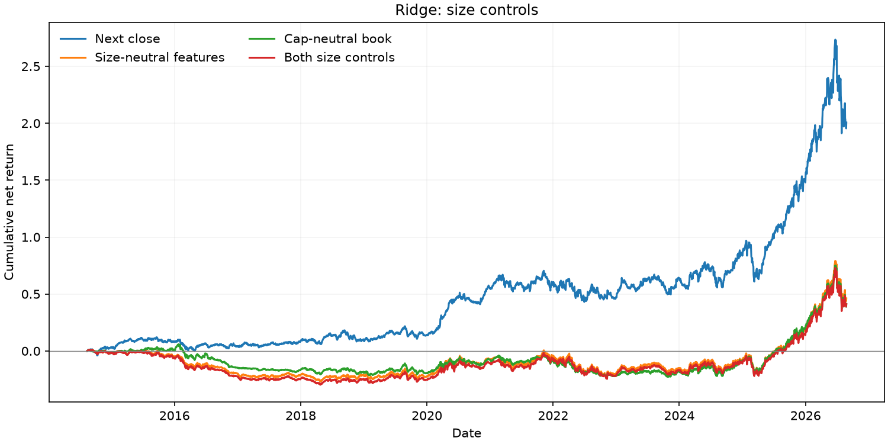

# Cross-sectional equity alpha

The strongest observed portfolio result is tied to familiar factor exposures,
including a material size tilt. Ridge achieves a next-close net Sharpe of 0.74;
seven factor portfolios explain 59% of its daily return variance, and its
factor-adjusted Sharpe is -0.21. A log-market-cap-neutral book reduces its Sharpe
to 0.29, with a 95% moving-block bootstrap interval of [-0.17, 0.91]. Historical
size effects in this current-constituent universe are vulnerable to survivorship
bias, and the tests provide limited evidence of additional alpha after factor
controls.

## Data

The panel contains 397 current S&P 500 constituents outside Financials and Real
Estate, with 1,391,906 observations from 2012-01-03 through 2026-10-30. Yahoo Finance
supplies adjusted daily prices, SEC EDGAR supplies first-filed financial statements,
and Wikipedia supplies the current constituent list and sectors. Fundamentals
become available on the business day after filing. Missing factor ranks are
imputed to zero after centering, retaining companies without gross margin.

The synthetic sample has the same file schemas, with market and sector factors,
Student-t returns and quarterly filings. The [data profile](docs/DATA_PROFILE.md)
describes the observed distributions.

## Method

The study compares an equal-weight composite of value, momentum, quality, low
volatility, size, beta and liquidity with ridge, histogram boosting and a small
neural network. Factors are winsorized and neutralized against sector and beta
before ranking; beta itself is only sector-neutralized. Rolling windows contain
504 training dates, a 21-date purge and 63 test dates.

Signals use close t, execute at close t+1 and predict excess returns from t+1 to
t+22. Each side of the quintile book receives exposure equal to NAV before costs,
and shares are held for 21 trading dates. Costs are 5 bp per dollar traded,
including entry and final liquidation. The neural model uses mini-batches, a
standardized target and early stopping on the purged final 20% of each training
window. The [configuration](docs/EXPERIMENT.md) specifies all model, execution,
size-control and bootstrap settings.

## Results

Out-of-sample signals span 2014-08-13 through 2026-08-21. The intervals below use
2,000 moving-block bootstrap draws with 63-date blocks. Four forecasts and seven
factors were tested, plus five execution/size variants; intervals are pointwise
and are not adjusted for multiple comparisons.

| Forecast | Monthly rank IC | Net annual return | Net Sharpe | Sharpe 95% interval | Max drawdown |
| --- | ---: | ---: | ---: | ---: | ---: |
| Equal-weight composite | 0.0038 | -0.3% | 0.02 | [-0.44, 0.57] | -31.5% |
| Ridge | 0.0161 | 9.6% | 0.74 | [0.31, 1.41] | -22.0% |
| Gradient boosting | 0.0118 | 7.1% | 0.59 | [0.18, 1.27] | -24.1% |
| Neural network | 0.0076 | 6.8% | 0.59 | [0.15, 1.16] | -17.4% |

Ridge's Sharpe is 0.69 with same-close execution, 0.30 with size-neutralized
features, 0.29 with a cap-neutral book, and 0.28 with both size controls. The
neural model has no consistent advantage after controls. The
[results notes](docs/RESULTS.md) report all comparisons, factor attribution and
training diagnostics; [saved metrics](reports/real/metrics.csv) and
[run metadata](reports/real/run.json) contain the numerical outputs and provenance.





## Limitations

Current-constituent survivorship, current sector classifications, XBRL concept
matching and vendor revisions limit the historical data. Next-close execution
still assumes fills at the closing price; financing and borrow costs are excluded.
Size constraints use signal-date information and can drift between rebalances.
The robustness tests reuse the same evaluated period, rather than a new
confirmatory sample.

## Reproduce

Install the optional neural dependencies for the full four-forecast experiment:

```bash
pip install -e ".[dev,data,neural]"
ruff check .
pytest -q
equity-alpha build-data --out data/real
equity-alpha run --panel data/real/panel.parquet --output-dir reports/real --include-neural
```

Set `SEC_USER_AGENT` to a name and contact before building data. For a run without
vendor access:

```bash
equity-alpha sample-data --out data/synthetic --days 2016
equity-alpha run --panel data/synthetic/panel.parquet --output-dir reports/synthetic --include-neural
```

Omit the `neural` extra and `--include-neural` flag for the three-forecast version.
Provider responses and current constituents can change between downloads. CI
checks both the base installation and the neural extra with a CPU build of PyTorch.
