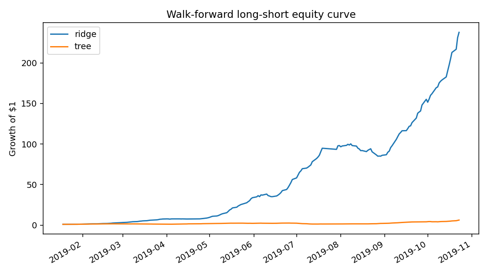

# Cross-Sectional Equity Alpha Research Pipeline

End-to-end Python research pipeline for cross-sectional equity alpha research:
factor construction, point-in-time hygiene, sector and beta neutralization,
ranking, portfolio formation, purged walk-forward validation, and model
comparison across linear, tree-based, and small neural-network forecasters.

This completed research engineering project demonstrates a reproducible
cross-sectional equity alpha workflow on deterministic synthetic data unless
explicitly documented otherwise.

## Target Resume Bullets

- Built a deterministic point-in-time synthetic equity panel with prices,
  sectors, market caps, fundamentals, liquidity, benchmark returns, and
  availability dates.
- Constructed value, momentum, quality, volatility, size, beta, and liquidity
  factors with sector/beta neutralization, cross-sectional ranking, and
  forward-return labels excluded from features.
- Implemented purged walk-forward validation comparing ridge, tree-based, and
  small neural-network return forecasters.
- Evaluated factor and portfolio behavior with IC, rank IC, turnover,
  transaction costs, drawdown, sector attribution, long-short returns, and
  reproducible CLI artifacts.

## Development

```bash
python3 -m venv .venv
source .venv/bin/activate
pip install -e ".[dev]"
pytest
```

## Run The Sample Pipeline

```bash
equity-alpha run --output-dir reports/generated
```

The command generates deterministic synthetic data in memory, constructs
point-in-time factors, creates forward excess-return labels, runs purged
walk-forward validation, fits ridge/tree/neural baselines, forms long-short
portfolios, and writes artifacts:

- `reports/generated/metrics.csv`
- `reports/generated/portfolio_returns.csv`
- `reports/generated/sector_attribution.csv`
- `reports/generated/predictions.parquet`
- `reports/generated/equity_curve.png`
- `reports/generated/research_report.md`
- `reports/generated/manifest.json`

## Sample Results

The chart below is produced with `equity-alpha run --output-dir reports/generated`
from deterministic synthetic data. It is useful for validating ranking,
walk-forward portfolio formation, cost handling, and report generation; it is
not a live-market performance claim.



For a faster smoke run without PyTorch training:

```bash
equity-alpha run --no-include-neural --assets 50 --days 500
```

Research controls can be set from the CLI for deterministic scenario checks:

```bash
equity-alpha run \
  --horizon 10 \
  --cost-bps 2.5 \
  --train-days 126 \
  --test-days 42 \
  --purge-days 10 \
  --embargo-days 5 \
  --no-include-neural
```

To write only the deterministic sample panel:

```bash
equity-alpha sample-data --output data/cache/sample_panel.parquet
```

## Implemented Scope

- Deterministic synthetic US-equity-like panel with prices, sectors, market
  caps, fundamentals, liquidity, benchmark returns, and explicit availability
  dates.
- Point-in-time factor construction for value, momentum, quality, volatility,
  size, beta, and liquidity signals.
- Sector and beta neutralization, cross-sectional ranking, and future labels
  that are excluded from features.
- Purged and embargo-stepped walk-forward validation.
- Ridge, histogram gradient boosting, and small PyTorch neural-network
  forecasters.
- IC, rank IC, turnover, cost-adjusted Sharpe, drawdown, sector attribution,
  signal spread diagnostics, positive-return rate, long-short portfolio
  returns, and generated Markdown/CSV/PNG artifacts with a checksum manifest.

The generated outputs are for engineering validation only. They use synthetic
data and should not be read as evidence of live-market profitability.

## Project Layout

```text
src/equity_alpha/
  data/          Deterministic sample panel generation
  research/      Factor construction and model baselines
  validation/    Purged walk-forward split logic
  portfolio/     Long-short portfolio construction and evaluation
  reporting/     CSV, Markdown, Parquet, and PNG artifact writers
  workflow/      End-to-end pipeline orchestration
  cli.py         Typer command line interface
tests/           Unit and CLI coverage for each layer
reports/         Reproducible generated research artifacts
```
