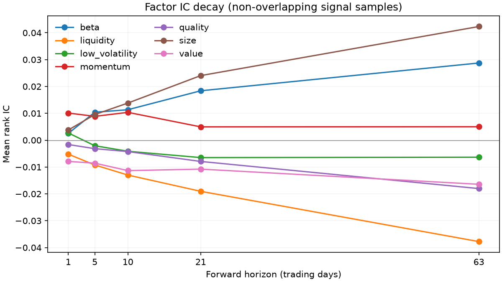

# Results and validation

The real experiment uses 48 rolling folds, with signal dates from
2014-08-13 through 2026-08-21. It covers 394 distinct
eligible companies after the trailing-history requirement, from a panel of
397 current constituents. Incomplete final test windows are omitted.
Each run's `run.json` records the modeling source commit, dependency versions,
active parameters and panel dimensions. Generator settings are recorded when the
pipeline generates a panel in memory; file-based runs describe the loaded panel.

Ridge has the highest realized daily net Sharpe,
0.71, with an annualized net return of
9.1% and maximum drawdown of -22.2%.

| Forecast | Monthly rank IC | IC t-statistic | Observations |
| --- | ---: | ---: | ---: |
| Equal-weight composite | 0.0012 | 0.15 | 144 |
| Ridge | 0.0156 | 1.45 | 144 |
| Gradient boosting | 0.0107 | 1.11 | 144 |
| Neural network | 0.0009 | 0.14 | 144 |

The monthly IC t-statistics provide limited evidence of a stable forecasting effect.
Current-constituent survivorship and idealized close execution limit the economic
interpretation of the portfolio results. Borrow and financing costs are excluded.

## Factor evidence

The factor statistics use the same out-of-sample signal window as the model
forecasts. Raw and neutralized statistics are available in
`reports/real/factor_ics.csv`; the table below shows centered neutralized ranks.

| Factor | Monthly rank IC | IC t-statistic |
| --- | ---: | ---: |
| value | -0.0118 | -1.24 |
| momentum | 0.0047 | 0.41 |
| quality | -0.0075 | -1.18 |
| low_volatility | -0.0072 | -0.92 |
| size | 0.0247 | 3.14 |
| beta | 0.0156 | 1.09 |
| liquidity | -0.0209 | -2.83 |



Raw factors retain sector and market exposures. Beta is neutralized against sector
only. The universe consists of current constituents, so historical size
associations reflect that selection.

Horizon-spaced IC samples avoid mechanical target overlap. They can still be
serially dependent, and the reported t-statistics use the sample-mean formula
without corrections for multiple comparisons. The annual plot averages daily IC
with overlapping targets and is descriptive.

## Accounting and availability

Portfolio returns compound the daily P&L of held shares. Costs apply to traded
dollars against drifted holdings, including entry and final liquidation. Sector
contributions sum arithmetic daily net returns and therefore do not add to the
compounded portfolio return.

Benchmark labels compound the next trading days and exclude the signal day.
Momentum lags use the common trading calendar. First-filed fundamentals become
available on the business day after filing. Missing factor ranks are imputed
after neutralization. Current-constituent selection and missing future endpoints
limit the historical universe.

## Data rebuild

The rebuild recorded 397 successful company downloads
and 0 skipped downloads. The snapshot comparison covers
1,391,906 common panel rows across 397 companies.
Adjusted prices can differ across downloads; the saved comparison records the
differences in each numeric field.

| Field | Maximum absolute difference | Missingness disagreements |
| --- | ---: | ---: |
| price | 0.00048828125 | 0 |
| daily_return | 1.8533319e-06 | 0 |
| benchmark_return | 1.2639794e-06 | 0 |
| market_cap | 0 | 0 |
| dollar_volume | 0 | 0 |
| book_to_price | 0 | 0 |
| gross_margin | 0 | 0 |
| accruals | 0 | 0 |
| debt_to_equity | 0 | 0 |

The aggregate comparison can be regenerated from two local datasets:

```bash
python scripts/check_rebuild.py --reference data/real --rebuilt data/real/rebuilt \
  --out reports/real/rebuild_check.json
```

## Synthetic results

The synthetic panel contains 100 assets over
2,016 business days, with the same model hyperparameters and
walk-forward layout as the real run. Pairwise correlation is
0.26 and within-sector correlation is
0.36; median annual volatility is
29.6%. Gross margin is absent for
30% of month-end rows.

Pooled excess return kurtosis is 3.07, compared with
62.41 in the real panel. The Student-t process
has less extreme tails than the observed crisis and event returns.

Synthetic forecast rank IC spans -0.0230 to
0.0171, and daily net Sharpe spans
-1.15 to 0.42.
The individual forecasts appear in `reports/synthetic/metrics.csv`.

This document is generated by `python scripts/write_result_notes.py` from the
saved aggregate tables.
