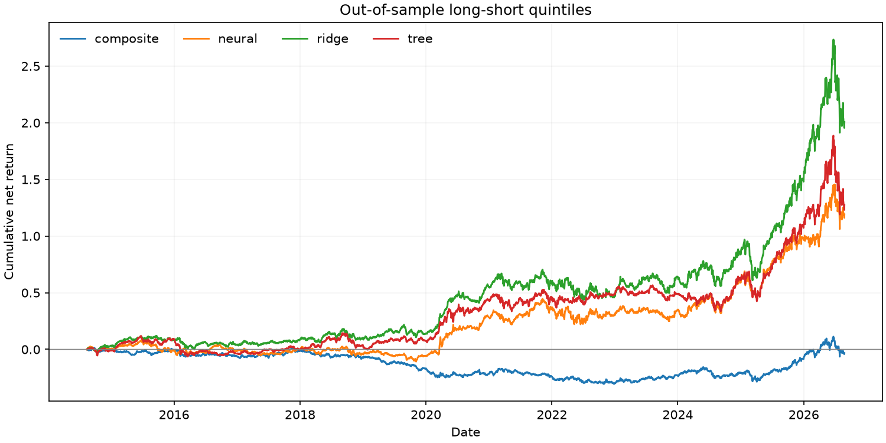
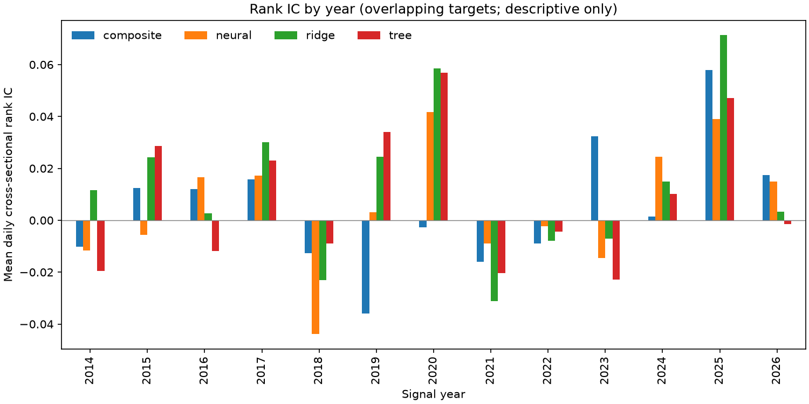
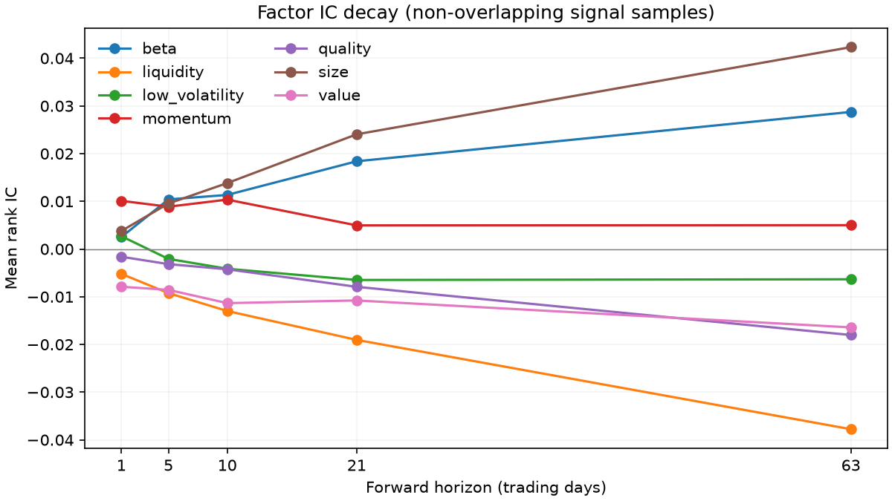

# Walk-forward research results

Source: `data/real/panel.parquet`. Test signals: 2014-08-13 through 2026-08-21.

IC summaries use non-overlapping signal dates; Sharpe uses daily net returns. The book holds shares between rebalances and pays costs on actual traded dollars, including entry and final liquidation. Sector contributions sum arithmetic daily net returns and do not add to compounded total return.

| model | mean_rank_ic | cost_adjusted_sharpe | portfolio_return | max_drawdown | annual_one_way_turnover_per_side |
| --- | --- | --- | --- | --- | --- |
| composite | 0.0012 | 0.0279 | -0.0220 | -0.3372 | 3.7662 |
| ridge | 0.0156 | 0.7062 | 1.8366 | -0.2225 | 2.9788 |
| tree | 0.0107 | 0.4906 | 0.9274 | -0.2336 | 4.4475 |
| neural | 0.0009 | 0.1814 | 0.1446 | -0.2870 | 4.7520 |

