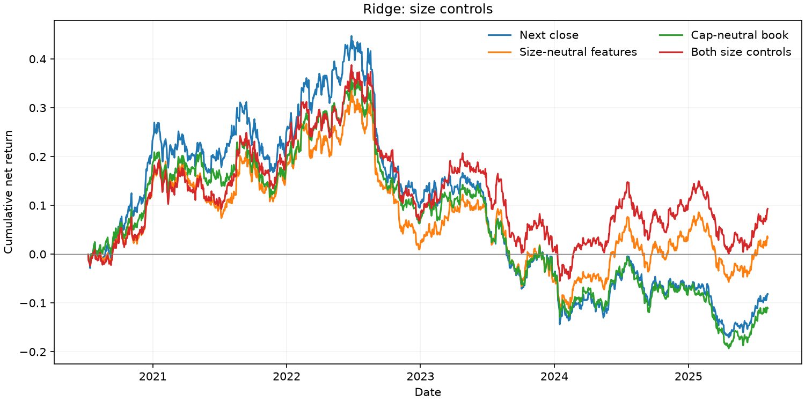

# Walk-forward research results

Source: `data/synthetic/panel.parquet`. Test signals: 2020-07-08 through 2025-08-01.

The main portfolio executes at the next close. IC summaries use non-overlapping signal dates; Sharpe uses daily net returns. Its 95% percentile intervals use moving blocks and are pointwise. 4 forecasts and seven factors are tested, plus the execution and size-control variants; intervals are not adjusted for multiple comparisons. Intervals require at least two blocks of daily observations. The book holds shares between rebalances and pays costs on actual traded dollars, including entry and final liquidation. Sector contributions sum arithmetic daily net returns and do not add to compounded total return.

| model | variant | mean_rank_ic | cost_adjusted_sharpe | sharpe_ci_lower | sharpe_ci_upper | portfolio_return | max_drawdown | annual_one_way_turnover_per_side |
| --- | --- | --- | --- | --- | --- | --- | --- | --- |
| composite | main | 0.0219 | 0.5144 | -0.6426 | 1.3965 | 0.2588 | -0.2452 | 3.0138 |
| ridge | main | -0.0037 | -0.0555 | -1.1235 | 0.8695 | -0.0816 | -0.4273 | 3.3334 |
| tree | main | -0.0045 | -0.1918 | -1.2630 | 0.8010 | -0.1293 | -0.3085 | 5.7035 |
| neural | main | -0.0221 | -0.3716 | -1.1507 | 0.4709 | -0.2086 | -0.3565 | 3.7390 |
| composite | same_close | 0.0171 | 0.4188 | -0.7353 | 1.3311 | 0.2012 | -0.2619 | 3.0133 |
| ridge | same_close | -0.0022 | -0.0543 | -1.1012 | 0.8602 | -0.0817 | -0.4265 | 3.3410 |
| tree | same_close | 0.0009 | -0.1533 | -1.1727 | 0.9350 | -0.1104 | -0.2818 | 5.7143 |
| neural | same_close | -0.0215 | -0.3505 | -1.1430 | 0.5057 | -0.1998 | -0.3531 | 3.7383 |
| composite | cap_neutral_book | 0.0219 | 0.3919 | -0.6271 | 1.2193 | 0.1720 | -0.2003 | 2.9377 |
| ridge | cap_neutral_book | -0.0037 | -0.1264 | -1.1635 | 0.7356 | -0.1111 | -0.4069 | 3.4271 |
| tree | cap_neutral_book | -0.0045 | -0.1879 | -1.2770 | 0.8112 | -0.1202 | -0.2846 | 5.8331 |
| neural | cap_neutral_book | -0.0221 | -0.5681 | -1.2958 | 0.2336 | -0.2729 | -0.3598 | 3.9111 |
| composite | size_neutral_features | 0.0298 | 0.6202 | -0.4034 | 1.4438 | 0.3455 | -0.1851 | 3.2358 |
| ridge | size_neutral_features | -0.0039 | 0.1126 | -0.8628 | 0.9700 | 0.0333 | -0.3383 | 3.3798 |
| tree | size_neutral_features | -0.0164 | -0.4766 | -1.5381 | 0.3471 | -0.2539 | -0.4041 | 5.8454 |
| neural | size_neutral_features | -0.0226 | -0.3625 | -1.2212 | 0.5412 | -0.2095 | -0.3607 | 4.0739 |
| composite | size_neutral | 0.0298 | 0.7529 | -0.1967 | 1.6162 | 0.4405 | -0.1659 | 3.5092 |
| ridge | size_neutral | -0.0039 | 0.1977 | -0.7693 | 1.0492 | 0.0930 | -0.3189 | 3.6185 |
| tree | size_neutral | -0.0164 | -0.4623 | -1.5015 | 0.3800 | -0.2391 | -0.3951 | 5.9783 |
| neural | size_neutral | -0.0226 | -0.4904 | -1.3460 | 0.4250 | -0.2574 | -0.3812 | 4.1951 |

